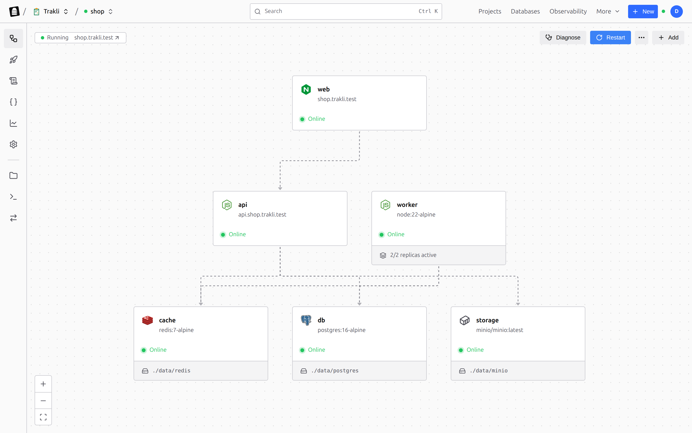

<p align="center">
  <a href="https://flatrun.dev">
    <picture>
      <source media="(prefers-color-scheme: dark)" srcset="https://flatrun.dev/flatrun-logo-white.svg">
      
    </picture>
  </a>
</p>

<p align="center">
  <a href="README.md">English</a> · Français · <a href="README.es.md">Español</a> · <a href="README.pt-BR.md">Português do Brasil</a> · <a href="README.zh-CN.md">简体中文</a>
</p>

# FlatRun

**Alternative open source et auto-hébergée à Railway et Render.** Déployez des projets Docker Compose sur vos propres serveurs.

FlatRun apporte le fonctionnement de Railway sur un serveur que vous contrôlez : des projets composés de services, des environnements, des déploiements que vous pouvez annuler, des variables partagées entre projets et des modèles pour les applications courantes. Chaque projet est un dossier avec un fichier Compose standard : il continue de tourner avec `docker compose` si vous arrêtez d'utiliser FlatRun.

Commencez avec un serveur. Connectez-en d'autres et faites évoluer les services adaptés avec Docker Swarm ou k3s lorsque la charge l'exige.

<picture>
  <source media="(prefers-color-scheme: dark)" srcset="docs/screenshots/project-architecture-dark.png">
  
</picture>

## Première application

Installez FlatRun sur Ubuntu ou Debian :

```bash
curl -fsSL https://raw.githubusercontent.com/flatrun/installer/main/scripts/install.sh | sudo bash
```

Ouvrez `http://<votre-serveur>:8080`, terminez la configuration, puis créez un
déploiement à partir d'un modèle, d'une image ou d'un fichier Compose. FlatRun
configure les conteneurs, le routage et HTTPS depuis le même tableau de bord.

Pour utiliser le terminal :

```bash
curl -fsSL https://raw.githubusercontent.com/flatrun/cli/main/scripts/install.sh | sudo sh
flatrun profile add production --url https://panel.example.com --token your-api-key-here
flatrun profile use production
flatrun health
```

## Ce que FlatRun apporte

- Des déploiements conservés comme fichiers et projets Docker Compose standards.
- Des plans qui montrent les changements avant leur application.
- La gestion des certificats, sauvegardes, tâches planifiées et accès limités.
- Des métriques par conteneur exportables avec OpenTelemetry et Prometheus.
- La gestion de plusieurs serveurs depuis un seul tableau de bord.
- La mise à l'échelle avec Docker Swarm ou k3s pour les charges compatibles.
- Des notifications regroupées en incidents utiles.
- Des espaces de travail pour les équipes, avec propriétaires, administrateurs et membres.
- Des secrets chiffrés, renouvelables, jamais réaffichés, ou fournis par Infisical, Vault, OpenBao, Doppler ou 1Password.
- Des variables qui font référence à celles d'un autre projet, et un historique de chaque déploiement avec ses journaux.

Le tableau de bord, le CLI, GitHub Actions et les intégrations externes utilisent
la même API. La description OpenAPI exacte de l'agent installé est disponible à
l'adresse `/api/openapi.json`.

Consultez la [documentation complète](https://flatrun.dev/docs) ou le
[README anglais](README.md) pour la configuration, le développement et le
dépannage.

## Licence

Licence MIT. Consultez [LICENSE](LICENSE).
