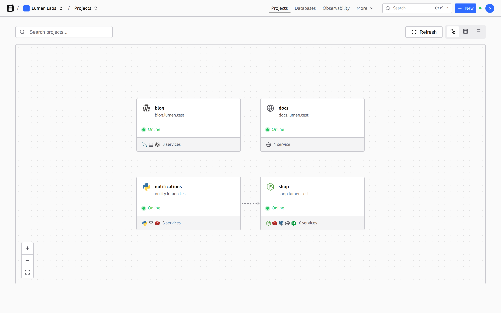

<p align="center">
  <a href="https://flatrun.dev">
    <picture>
      <source media="(prefers-color-scheme: dark)" srcset="https://flatrun.dev/flatrun-logo-white.svg">
      
    </picture>
  </a>
</p>

<p align="center">
  <a href="README.md">English</a> · <a href="README.fr.md">Français</a> · <a href="README.es.md">Español</a> · Português do Brasil · <a href="README.zh-CN.md">简体中文</a>
</p>

# Execute aplicações em contêineres nos seus próprios servidores

O FlatRun permite implantar, proteger, diagnosticar, automatizar e gerenciar
aplicações em contêineres em um só lugar. Ele executa projetos Docker Compose
padrão diretamente e pode escalar cargas compatíveis com Docker Swarm ou k3s.

Seus arquivos Compose, configurações e dados permanecem nas suas máquinas.
Comece com um único host Docker, conecte outros servidores e ative a
orquestração quando a carga precisar.

## Primeira aplicação

Instale o FlatRun no Ubuntu ou Debian:

```bash
curl -fsSL https://raw.githubusercontent.com/flatrun/installer/main/scripts/install.sh | sudo bash
```

Abra `http://<seu-servidor>:8080`, conclua a configuração e crie uma implantação
a partir de um modelo, uma imagem ou um arquivo Compose. O FlatRun configura os
contêineres, o roteamento e o HTTPS no mesmo painel.

Para trabalhar pelo terminal:

```bash
curl -fsSL https://raw.githubusercontent.com/flatrun/cli/main/scripts/install.sh | sudo sh
flatrun profile add production --url https://panel.example.com --token your-api-key-here
flatrun profile use production
flatrun health
```

## Visão geral

Cada projeto é uma pasta com um arquivo Compose. O painel mostra os projetos em uma tela, com domínio, estado e serviços. Ao abrir um projeto, você vê os serviços e como eles dependem uns dos outros.

<picture>
  <source media="(prefers-color-scheme: dark)" srcset="docs/screenshots/projects-canvas-dark.png">
  
</picture>

<picture>
  <source media="(prefers-color-scheme: dark)" srcset="docs/screenshots/project-architecture-dark.png">
  
</picture>


## O que o FlatRun oferece

- Implantações mantidas como arquivos e projetos Docker Compose padrão.
- Planos que mostram as mudanças antes da aplicação.
- Gestão de certificados, backups, tarefas agendadas e acesso limitado.
- Métricas por contêiner exportáveis com OpenTelemetry e Prometheus.
- Gestão de vários servidores em um único painel.
- Escalabilidade com Docker Swarm ou k3s para cargas compatíveis.
- Notificações relacionadas agrupadas em incidentes úteis.
- Espaços de trabalho para equipes, com proprietários, administradores e membros.
- Segredos criptografados, rotacionáveis e nunca exibidos novamente, ou fornecidos por Infisical, Vault, OpenBao, Doppler ou 1Password.
- Variáveis que referenciam as de outro projeto, e um histórico de cada implantação com seus logs.

O painel, o CLI, o GitHub Actions e as integrações externas usam a mesma API. A
descrição OpenAPI exata do agente instalado está disponível em
`/api/openapi.json`.

Consulte a [documentação completa](https://flatrun.dev/docs) ou o
[README em inglês](README.md) para configuração, desenvolvimento e solução de
problemas.

## Licença

Licença MIT. Consulte [LICENSE](LICENSE).
